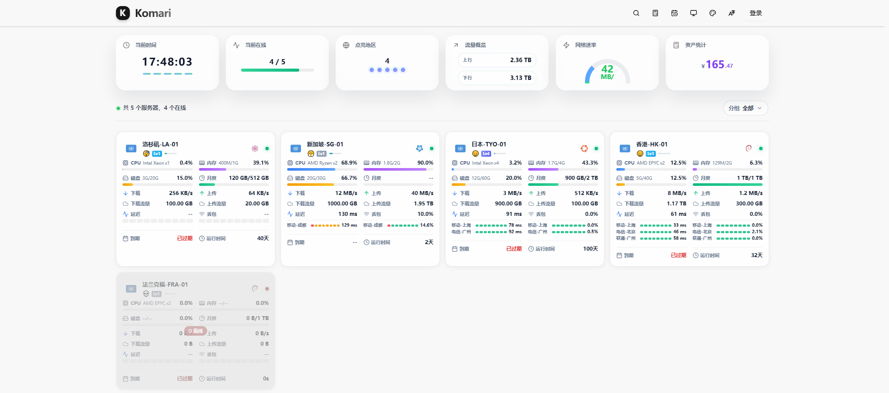

# Komari Next Classic

A custom frontend theme for [Komari](https://komari-document.pages.dev/) — **v2.0.0**.

Komari Next Classic is a reworked Komari dashboard theme. It ships **only the frontend
theme**: no companion backend, no extra services, no probes. Upload the theme package to a
stock Komari server and it works.

- Theme manifest: `theme/komari-theme.json` — `name: Komari Next Classic`, `short: komari-next-classic`, `version: 2.0.0`
- Stack: Next.js 16 (static export) · React 19 · TypeScript · Tailwind CSS 4 · Radix UI



## Highlights

**Homepage**

- Six status cards directly under the navbar: current time (with timezone selector), online
  nodes, region overview, traffic overview, network speed, asset overview
- Node cards show the CPU model × core count, memory and disk usage (used/total), and one row
  per monitoring point with name + colour bar + latency / packet loss (up to three rows, then folded)
- Group switcher and node search live in one slim toolbar line — no oversized search card

**Instance detail page**

- Load and latency charts, network quality panel
- Processor card with CPU specification lines
- Expiry timeline (calendar button in the navbar) and the asset overview panel

**Interaction**

- Search button at the left of the navbar opens a search popover; `/` focuses it, `Esc` clears
  the query first and closes on a second press
- Theme-managed configuration through the Komari admin panel
- Multi-language via the Komari language files (`en`, `zh_CN`, `zh_TW`, `ja_JP`, `id_ID`)
- Build-time enhancements injected into every built page: expiry reminder + asset calculator
  buttons, mood/level widgets, asset calculation fix

## Install

### Option A — install the packaged theme (recommended)

1. Download the release asset `komari-next-classic-v*.zip`
2. Komari admin → **Theme management → Upload theme / Update theme**
3. The package root contains `komari-theme.json`, `preview.png` and `dist/` and can be uploaded as is

> Do **not** upload the GitHub source ZIP as a theme package — it has no built assets.

### Option B — build from source

```bash
cd theme
npm ci
npm run build        # next build + postbuild enhancement injection
./build-theme.sh     # optional: package into dist/komari-next-classic-v<date>-<commit>.zip
```

Then deploy `theme/dist/` together with `theme/komari-theme.json` and `theme/preview.png`.

Requirements:

- **Node.js 20+** (Next.js 16)
- **Python 3** — the `postbuild` step (`python inject-enhancements.py`) injects the enhancement
  scripts into the built HTML. Skipping it leaves out the expiry/asset buttons and mood widgets.

## Configuration

Everything is configured from the Komari admin panel (theme settings):

| Setting | Notes |
|---|---|
| `colorTheme` | 6 presets: `default`, `ocean`, `sunset`, `forest`, `midnight`, `rose` |
| `backgroundImageUrl` | Background image URL |
| `logoImageUrl` | Logo image URL |
| `showAssetCalculatorButton` | Floating asset calculator button |
| `statusCardsVisibility.*` | Per-card visibility: `currentTime`, `currentOnline`, `regionOverview`, `trafficOverview`, `networkSpeed`, `assetOverview` |
| `showMoodSystem`, `showLevelSystem` | Mood / level widgets |

The theme additionally reads `cardLayout` and `selectedTimeZone` from the stored theme config.
The timezone selector sits on the "current time" card and only affects that card.

## Development

```bash
cd theme
npm ci
npm run dev            # dev server
npm run build          # production build + enhancement injection
python inject-enhancements.py --check   # verify the injection is in place (idempotent)
npx tsc --noEmit       # type check
npx eslint src         # lint
npm run i18n:sync:dry  # i18n key diff (npm run i18n:sync writes, needs OPENAI_API_KEY)
```

Source, build and packaging notes:

- `src/` — theme source (Next.js app router)
- `enhancements/` — runtime enhancement scripts injected after the build
- `inject-enhancements.py` — idempotent injector, runs automatically as `postbuild`
- `build-theme.sh` — packages `preview.png` + `komari-theme.json` + `dist/` into a release zip
- `preview.png` — theme store preview image

## Repository layout

```text
.
├── theme/
│   ├── src/                  # theme source (components, contexts, i18n, styles)
│   ├── public/               # static assets
│   ├── enhancements/         # injected enhancement scripts
│   ├── script/               # i18n sync helper
│   ├── dist/                 # build output (git-ignored, shipped in release zips)
│   ├── komari-theme.json     # theme manifest
│   ├── preview.png           # theme preview image
│   ├── inject-enhancements.py
│   └── build-theme.sh
├── README.md
├── README-CN.md
├── SECURITY.md
└── LICENSE
```

## Credits

Komari Next Classic is a modified fork of **Komari Next Pro** by LIU
(<https://github.com/fanchengliu/komari-next-pro>), itself derived from the Komari Next theme.

Changes in this fork:

- renamed to Komari Next Classic, theme version bumped to `2.0.0`
- removed the optional `unlock-probe` backend, the stream-unlock panel and the IP-info panel
- removed the companion-behind-a-reverse-proxy requirement: the theme now needs nothing but Komari
- dropped the unreachable upstream code (admin panel module, unused UI primitives and helper
  components — around 50 files) and fixed every lint error, so `npx eslint src` reports no errors
- all five bundled locales are key-complete and in sync (**95 keys each**: 584 keys the project
  never references were removed, shrinking the locale files from 175 KB to 24 KB; upstream locales
  can simply be copied back over if you ever want the full set)
- mobile layout is matched rule-by-rule against the author's shipped pre-built bundle
  (cards stay two-column, status-card padding, row gaps / progress-bar thickness,
  mobile detail-page chart sizing); the preview screenshot is now a real capture of the current UI
- frontend fixes and cleanups on top of the upstream theme (6 more zero-reference files removed:
  `LoadChart.tsx`, `utils/index.ts` plus the 3 helper modules only it re-exported, `rpc2.ts.rej`;
  line endings normalised to LF)

## License

[MIT](./LICENSE) — the original copyright notice is retained.
